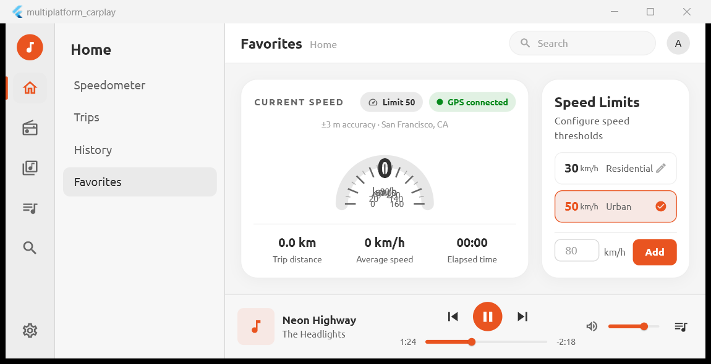

# Multiplatform CarPlay — With Parking Camera

A desktop **car-infotainment** concept app built with Flutter. It presents a
Microsoft Teams–inspired layout (vertical nav rail + secondary sidebar + content
area + persistent player) styled with the **Yaru** light theme, and adds **live
camera** screens for a right-mirror feed and a rear/parking camera with
**calibratable parking guidelines**.

> **Status: work in progress.** The shell, navigation, theming, live camera
> preview and parking-line calibration are functional. Several sections
> (map, radio, playlists, most settings pages) are still placeholders.



---

## Features

### Implemented
- **Teams-style shell** — 64 px nav rail, 220 px contextual secondary sidebar,
  content area and a compact music player pinned to the bottom.
- **Home dashboard** — speedometer gauge (custom painter), speed-limit card and
  trip stats.
- **Map** — a styled placeholder map view (`lib/layout/map/map_screen.dart`).
- **Right mirror camera** — live preview with a mirror band + direction chevrons.
- **Parking camera** — live preview with **golden** left/right parking guidelines
  and live calibration.
- **Live calibration** (right card, toggled with the gear icon):
  - **Zoom** — digital zoom applied to the feed.
  - **Car width (line spacing)** — 0–100 %, where 100 % spans the view corners.
  - **Line angle** — 0 % = lines meet at the top, 100 % = parallel.
  - Plus quick toggles: **Beeper sound** and **Show lines**.
- **Camera detection & assignment** — enumerate OS cameras and assign one to the
  right mirror and one to the rear/parking slot.
- **Persistent settings** — everything above is stored locally in SQLite and
  restored on launch, including the last opened section.
- **Toast notifications** — lightweight pill toasts instead of snackbars.

### Placeholder / not finished
- Map, Radio and Playlists content.
- Settings pages other than **Cameras** (Appearance, Playback, Account, About).
- Trip history, saved places, snapshots, sensors.
- Audio playback in the music player is UI-only.

---

## Tech stack

| Area            | Choice |
| ---             | ---    |
| UI framework    | Flutter (Dart SDK `^3.12.1`) |
| Target platform | **Windows desktop** (only platform currently wired up) |
| Theme           | [`yaru`](https://pub.dev/packages/yaru) light theme + Ubuntu font |
| Camera          | [`camera`](https://pub.dev/packages/camera) + [`camera_windows`](https://pub.dev/packages/camera_windows) |
| Storage         | [`sqflite_common_ffi`](https://pub.dev/packages/sqflite_common_ffi) + [`sqlite3_flutter_libs`](https://pub.dev/packages/sqlite3_flutter_libs) |
| Paths           | [`path_provider`](https://pub.dev/packages/path_provider) + [`path`](https://pub.dev/packages/path) |

---

## Project layout

```
lib/
├─ main.dart                     # App entry, SQLite init, MaterialApp/Yaru theme
├─ settings/
│  └─ settings_store.dart        # SQLite-backed settings + CameraConfig
├─ yaru_gallery/
│  └─ tokens.dart                # Colour/typography design tokens
└─ layout/
   ├─ app_shell.dart             # Shell: nav rail + sidebar + content + player
   ├─ app_data.dart              # Nav sections and sidebar items
   ├─ nav_rail.dart              # Primary icon rail
   ├─ secondary_sidebar.dart     # Contextual list per section
   ├─ content_page.dart          # Content host
   ├─ music_player.dart          # Bottom player
   ├─ app_toast.dart             # showAppToast() pill notifications
   ├─ camera/
   │  └─ camera_screen.dart      # Live preview + overlays + calibration controls
   ├─ dashboard/
   │  ├─ speedometer_dashboard.dart
   │  ├─ speedometer_gauge.dart
   │  ├─ speed_limits_card.dart
   │  └─ dashboard_card.dart     # Shared card decoration
   ├─ map/
   │  └─ map_screen.dart
   └─ settings/
      ├─ settings_screen.dart    # Cameras detection + assignment UI
      └─ camera_devices.dart     # Camera enumeration helpers
```

---

## Getting started

### Prerequisites
- **Flutter** with Windows desktop support enabled
  (`flutter config --enable-windows-desktop`).
- **Visual Studio 2022** with the *Desktop development with C++* workload.
- A webcam (the Windows camera plugin enumerates OS cameras).

### Run

```powershell
flutter pub get
flutter run -d windows
```

The window is fixed at **920 × 473** logical pixels (see
`windows/runner/main.cpp`) to emulate an in-dash display.

### Optional CLI arguments
The app accepts two positional arguments (mainly useful for scripting/testing):

```powershell
# open a section: home | map | right_mirror | parking | radio | playlists | settings
multiplatform_carplay.exe parking

# open a section and select a secondary-sidebar item
multiplatform_carplay.exe settings Cameras
```

With no argument the app resumes the **last opened section**.

---

## Parking-line calibration

Open the **Parking** (or **Right mirror**) section, then tap the **gear icon**
on the right card to switch from the toggles to the calibration sliders:

1. **Car width** — align the golden guidelines with the real parking space
   width. `100 %` makes them reach the view corners.
2. **Line angle** — tilt the guidelines so they follow the parking bay sides
   (the top width is this fraction of the bottom width).
3. **Zoom** — applies digital zoom to the feed.

Values are stored **per camera** and reloaded automatically. The guidelines are
drawn as a fraction of the viewport, so changing to a different (or
higher-resolution) camera keeps them correct — nothing is hardcoded to a
specific sensor.

---

## Settings & persistence

Settings are stored in a SQLite database:

```
%APPDATA%\com.example\multiplatform_carplay\carplay_settings.db
```

Schema (v2):

- `kv(key TEXT PRIMARY KEY, value TEXT NOT NULL)` — last section, camera
  assignments, beeper/lines toggles.
- `camera_settings(camera_id TEXT PRIMARY KEY, zoom REAL, distance REAL,
  car_width REAL, line_angle REAL)` — per-camera calibration.

If the database can't be opened, the app falls back to in-memory defaults so it
still runs.

---

## Development

```powershell
flutter analyze          # static analysis (kept clean)
flutter test             # widget tests
flutter build windows --debug
```

Widget tests load the real Ubuntu font and render at 920 × 473 to match the
desktop window.

---

## Known limitations

- Only the **Windows** runner is currently configured.
- Camera enumeration relies on the Windows camera plugin; device names/order can
  vary between machines.
- Several screens are visual placeholders (see *Placeholder / not finished*).

---

## License

No license file yet — add one before distributing.
